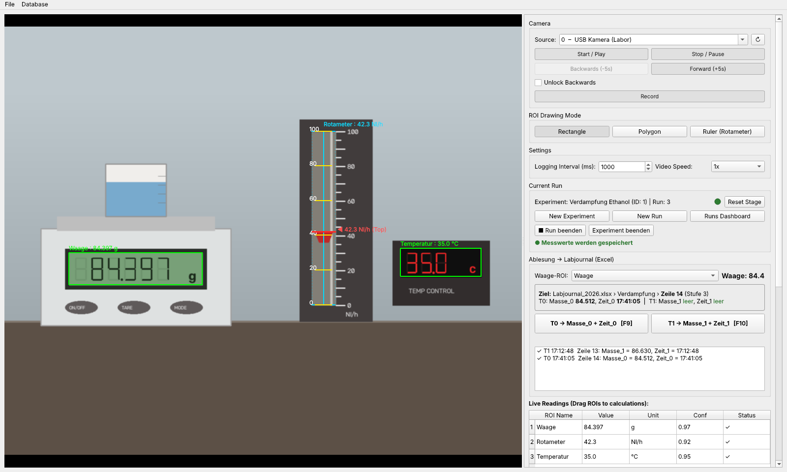
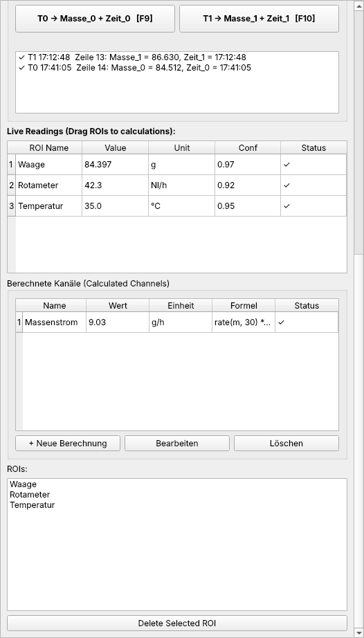
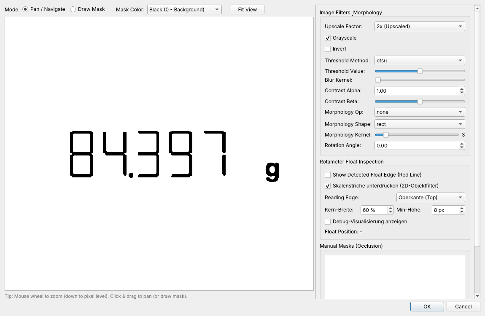
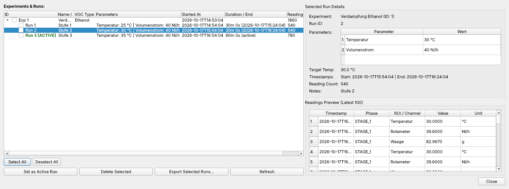

# InstrumentReader

**Laborgeräte per Kamera ablesen, statt Werte von Hand abzuschreiben.**
InstrumentReader erkennt Waagen, 7-Segment-Anzeigen und Rotameter im Kamerabild,
liest die Werte mit OCR bzw. Bilderkennung und loggt sie live in eine
SQLite-Datenbank. Aufnahmen lassen sich später offline mit derselben Zeitachse
auswerten.



*Im Kamerabild markierte Messbereiche (ROIs): Waage und Temperaturregler werden per OCR gelesen,
das Rotameter über die Lage des Schwimmers auf einer kalibrierten Skala. Rechts laufen die
erkannten Werte live mit.*

## Wofür?

- **Langzeitmessungen ohne Datenlogger-Schnittstelle:** Ältere Waagen, Regler oder Anzeigen
  ohne PC-Anschluss werden einfach abgefilmt. Die Werte landen mit Zeitstempel in der Datenbank.
- **Verdampfungs- und Massenstromversuche:** Aus dem Waagensignal rechnet die App z. B. den
  Massenstrom in g/h. Stufenwechsel (Nachfüllen, Umsetzen) erkennt sie und rechnet sie heraus.
- **Gasdurchfluss am Rotameter:** Schwimmerposition entlang eines frei drehbaren Lineals, mit
  eigener Kalibrierung.
- **Laborjournal in Excel:** Mit F9/F10 Waagenwert und Uhrzeit direkt in die offene Zeile
  des Labjournals schreiben.
- **Nachträgliche Auswertung:** Ein aufgenommenes Video wird mit bis zu 10-facher Geschwindigkeit
  oder „so schnell wie möglich“ nachgelesen, die Zeitachse stimmt trotzdem.

<table>
  <tr>
    <td width="36%"></td>
    <td>
      <b>Live-Werte und Rechenkanäle</b><br>
      Jede ROI erscheint mit Wert, Einheit, OCR-Konfidenz und Plausibilitätsstatus. ROIs lassen
      sich per Drag &amp; Drop in Formeln ziehen, z.&nbsp;B. <code>rate(m, 30) * 3600</code> für den
      Massenstrom in g/h.
      <br><br>
      <b>Vorverarbeitung pro Messbereich</b><br>
      Schwellwert, Kontrast, Morphologie, Drehung und Masken lassen sich pro ROI einstellen, mit
      Vorschau bis auf Pixelebene:
      <br><br>
      
    </td>
  </tr>
</table>

**Experimente und Runs im Dashboard:** Messungen sind in Experimente und Runs gegliedert, mit
frei wählbaren Parametern wie Temperatur oder Volumenstrom. Das Dashboard zeigt Dauer,
Anzahl Messwerte und eine Vorschau, setzt beendete Runs fort und exportiert mehrere Runs
gemeinsam als CSV.



## Installation und Start

Voraussetzungen: Python ≥ 3.11, [uv](https://docs.astral.sh/uv/) und Tesseract
(siehe unten).

```
uv run instrument-reader
```

`uv` legt beim ersten Start die Umgebung in `.venv` an. Tests laufen mit:

```
uv run --extra dev pytest
```

## Bedienung im Überblick

- **Quelle:** Kamera im Dropdown wählen (mit Gerätenamen), einen Index eintippen
  oder einen Videopfad eingeben. Reine DirectShow-Kameras wie die OBS Virtual
  Camera stehen unter Indizes ab 700 (`701` = DirectShow-Gerät 1).
- **ROIs:** Bereiche als Rechteck, Polygon oder Lineal (Rotameter) einzeichnen.
  Pro ROI lässt sich die Schriftart für die OCR wählen (siehe unten). ROI-Sätze
  lassen sich unter *File → Save/Load ROI Preset* speichern und laden.
- **Rechenkanäle:** Formeln aus den gemessenen Kanälen bilden, z. B. Raten.
- **Experimente und Runs:** *New Experiment* / *New Run* gliedern die Messung. *Run beenden*
  stoppt die Speicherung (Kamera und Aufnahme laufen weiter), *Experiment beenden* schließt das
  Experiment. Beendete oder abgebrochene Runs lassen sich im *Runs Dashboard* fortsetzen.
  Die Stufenerkennung für Waagen zeigt die aktuelle Stufe an (*Reset Stage* setzt
  sie zurück). Das *Runs Dashboard* vergleicht Runs und exportiert sie als CSV.
- **Wiedergabe:** Bei Videos Geschwindigkeit 0,5× bis 10× oder „Max“ (so schnell
  wie möglich, ohne Messintervalle zu überspringen). Zurückspulen muss erst
  freigeschaltet werden.

- **Ablesung → Labjournal:** Labjournal in Excel öffnen, Cursor in die Zeile des Messschritts
  setzen, Waagen-ROI wählen. **F9 (T0)** schreibt Waagenwert und Uhrzeit in Masse_0/Zeit_0,
  **F10 (T1)** in Masse_1/Zeit_1 dieser Zeile. Die Tasten gehen auch, wenn Excel vorne ist.
  Belegte Zellen werden nie überschrieben; das Panel zeigt vorher, wohin geschrieben wird.
  Jeder Tastendruck steht zusätzlich in `ablesungen/Ablesungen_<Datum>.csv`.
  `INSTRUMENT_READER_EXCEL=0` schaltet die Excel-Anbindung und die Tasten ab.

Alle Daten liegen im Datenordner, siehe [Datensicherheit](#datensicherheit).

## Datensicherheit

Alle Messdaten liegen **außerhalb des Programmordners** in
`%USERPROFILE%\InstrumentReader-Daten\` (änderbar mit `INSTRUMENT_READER_DATA_DIR`).
Kein Git-Befehl im Programmordner kann sie damit überschreiben oder löschen. Liegt der
Datenordner selbst in einem Git-Ordner, startet die App nicht.

| Datei / Ordner | Inhalt |
|---|---|
| `instrument_reader.db` | Die Datenbank (Experimente, Runs, Messwerte, ROI-Presets) |
| `journal/JJJJ-MM-TT.jsonl` | **Nur anhängbares Journal** aller Schreibvorgänge; vergangene Tage schreibgeschützt |
| `backups/` | Automatische Backups: beim Start, nach jedem Run, alle 30 min und beim Schließen |
| `recordings/` | Videoaufnahmen mit Zeitstempel-Dateien |
| `ablesungen/` | Protokoll jedes T0/T1-Tastendrucks, pro Tag eine `.csv` |
| `state.json` | Wie viele Daten beim letzten Mal da waren |
| `settings.json` | Optional, z. B. `{"backup_mirror": "D:\\Backups"}` |

- **Erster Start der neuen Version:** Eine `instrument_reader.db` im Startordner wird
  einmalig in den Datenordner **kopiert**. Die alte Datei bleibt liegen.
- **Backups** werden ausgedünnt: alle der letzten 24 Stunden (48 Stück), dann eins pro Tag für
  30 Tage, danach eins pro Woche. Mit `INSTRUMENT_READER_BACKUP_MIRROR` oder `backup_mirror`
  in `settings.json` geht jedes Backup zusätzlich in einen zweiten Ordner (z. B. OneDrive oder NAS).
- **Fehlt die Datenbank beim Start oder enthält sie weniger als beim letzten Mal**, fragt die
  App nach, statt leer weiterzumachen, und bietet das neueste Backup an.
- **Aus dem Journal neu aufbauen:** `python scripts/rebuild_db.py` schreibt eine neue Datei
  `instrument_reader_rebuilt_<Zeit>.db` in den Datenordner; die bestehende Datenbank wird nicht
  angefasst. Das Journal enthält alles ab dem ersten Start dieser Version, ältere Daten stecken in
  den Backups.
- **Messen und Entwickeln trennen:** Gemessen wird aus einem Ordner, in dem während einer Messung
  kein Git-Befehl läuft. Entwickelt wird in einem zweiten Klon oder Worktree mit eigenem
  `INSTRUMENT_READER_DATA_DIR`.

## Kamera

Live-Kameras werden in einem eigenen Hilfsprozess gelesen. Stürzt der
Kameratreiber oder der Windows-Kameradienst ab, endet nur dieser Prozess. Die App
startet ihn neu, Messung und Aufnahme laufen weiter.

Fällt die Kamera aus, verbindet die App automatisch neu. Sie folgt der Kamera per
Name, auch wenn Windows die Geräte neu nummeriert. Klappt die Verbindung 3-mal
nicht, versucht sie dieselbe Kamera über den anderen Windows-Treiberweg
(DirectShow bzw. Media Foundation). Die Statuszeile zeigt das an.

`INSTRUMENT_READER_CAMERA_HELPER=0` liest die Kamera ohne Hilfsprozess direkt in
der App (nur zur Fehlersuche).

Auf Windows sollte der Grafiktreiber aktuell sein: Der Windows-Kameradienst nutzt
ihn, und ein alter AMD-Treiber hat ihn wiederholt abstürzen lassen. Während einer
Messung die eingebaute Laptop-Kamera nicht ein- oder ausschalten, das kann den
Dienst für alle Kameras abstürzen lassen.

## Aufnahme

*Record* speichert das Kamerabild in `recordings/recording_<Datum>_<Uhrzeit>.mkv` im Datenordner.
MKV bleibt auch nach einem Absturz oder Stromausfall lesbar.

Daneben liegt `<name>.timestamps.csv` mit der Aufnahmezeit jedes Bildes (etwa
19 MB für 8 h bei 30 fps). Beim Abspielen nutzt die App diese Zeiten, damit
Lücken (z. B. durch einen Kameraausfall) ihre echte Länge behalten. Beim Kopieren
oder Verschieben einer Aufnahme die CSV mitnehmen und im selben Ordner lassen.
Ohne sie rechnet die App die Zeit aus Dateiname und Bildnummer.

## Tesseract einrichten

Die App braucht ein installiertes [Tesseract](https://github.com/tesseract-ocr/tesseract)
(Windows: z. B. der UB-Mannheim-Installer) und für Sieben-Segment-Anzeigen das
Sprachmodell `lets.traineddata` im `tessdata`-Ordner.

Pro ROI lässt sich im ROI-Dialog unter „Schriftart (OCR)" wählen, welches Modell
benutzt wird: „7-Segment / LCD" nimmt `lets`, „Normale Schrift" (z. B. Waagen mit
normalen Ziffern) nimmt `eng`. `lets` verliest normale Ziffern, etwa eine 4 als 0 oder 1.

Tesseract wird in dieser Reihenfolge gesucht:

1. Umgebungsvariable `INSTRUMENT_READER_TESSERACT` (voller Pfad zu `tesseract`/`tesseract.exe`)
2. `tesseract` im `PATH`
3. `C:\Program Files\Tesseract-OCR\tesseract.exe`

Der `tessdata`-Ordner kann mit `INSTRUMENT_READER_TESSDATA` (oder `TESSDATA_PREFIX`) gesetzt werden.

### Schnellere OCR mit tesserocr (optional)

Mit dem Paket `tesserocr` läuft Tesseract direkt im Programm, die Modelle bleiben
geladen und ein Frame ist über 15-mal schneller als mit dem `tesseract`-Programm:

```
uv sync --extra fast        # Linux / macOS
conda install -c conda-forge tesserocr   # Windows (PyPI hat dort keine fertigen Pakete)
```

Ist `tesserocr` installiert, wird es automatisch benutzt. Erzwingen lässt sich das
Backend mit `INSTRUMENT_READER_OCR_BACKEND=tesserocr` bzw. `=cli`.

Zeitmessung: `python scripts/benchmark_ocr.py`

## Umgebungsvariablen

| Variable | Wirkung |
|---|---|
| `INSTRUMENT_READER_TESSERACT` | Pfad zu `tesseract`/`tesseract.exe` |
| `INSTRUMENT_READER_TESSDATA` | Ordner mit `*.traineddata` |
| `INSTRUMENT_READER_OCR_BACKEND` | `auto` (Standard), `tesserocr` oder `cli` |
| `INSTRUMENT_READER_CAMERA_HELPER` | `0`: Kamera ohne Hilfsprozess lesen |
| `INSTRUMENT_READER_DATA_DIR` | Datenordner (Standard `%USERPROFILE%\InstrumentReader-Daten`) |
| `INSTRUMENT_READER_BACKUP_MIRROR` | Zweiter Ordner für jede Datenbank-Sicherung |
| `INSTRUMENT_READER_EXCEL` | `0`: keine Excel-Anbindung, F9/F10 nicht systemweit |

Änderungen stehen in [CHANGELOG.md](CHANGELOG.md).

Die Bilder in dieser README zeigen die echte Oberfläche mit einer künstlichen Laborszene und
Beispieldaten. Neu erzeugen: `uv run python scripts/readme_screenshots.py`.
